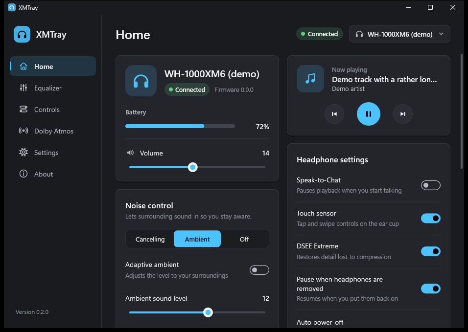
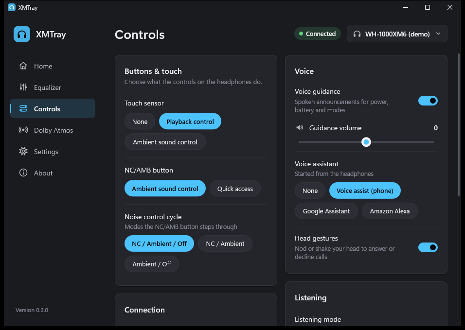

# XMTray

Unofficial desktop control for Sony Bluetooth headphones on Windows 10/11: noise cancelling, ambient sound, equalizer, battery, codec info and more, from a tray app. Single portable exe, standard user, no network access.

> Not affiliated with or endorsed by Sony or Dolby. Trademarks belong to their owners.

**Status: built and UI-tested with simulated headphones only. Not yet verified against real hardware.**



## Features

- Noise cancelling / ambient (level, focus on voice) / off
- Equalizer with 5 or 10 bands (per model), device presets, Clear Bass, your own saved curves
- Battery (single or left / right / case) on the tray icon, charging state
- Volume, Speak-to-Chat, touch sensor, DSEE, auto power-off, pause on removal, connection priority, power off
- Codec reported by the headphones (SBC / AAC / LDAC / aptX) and the Windows output format
- Several headphones: pick one; optionally route Windows audio to it and follow the Windows output device
- Multipoint: connected sources and playback switching (protocol v2 models)
- Per-model controls: button / touch assignment, NC/AMB button cycle, adaptive ambient, listening modes, voice guidance, voice assistant, head gestures, automatic source switching, pairing mode, safe-listening level, playback control and track info
- Spatial sound status (Off / Windows Sonic / Dolby Atmos for Headphones), an on/off attempt, and a shortcut to Dolby Access
- Experimental, opt-in: switch Dolby Access sound modes (see "Dolby")
- Notifications on connect, disconnect and low battery
- Connects on demand; the control link is dropped shortly after the window is hidden

Supported models are whatever [libmdr](https://github.com/mos9527/SonyHeadphonesClient) supports; features vary by model and firmware. See [docs/SUPPORT.md](docs/SUPPORT.md) for the per-model matrix (the original MDR-1000X has no evidence of working).



### LDAC

An app cannot add a Bluetooth codec to Windows. LDAC needs a third-party kernel A2DP driver; XMTray ships none. What XMTray does: show the codec the headphones report and let you set the headphones' connection priority to sound quality. Details and a checklist: [docs/LDAC.md](docs/LDAC.md).

### Dolby

Windows exposes the active spatial sound format, which XMTray shows. Turning Dolby Atmos on or off is attempted through the documented API, which Windows may refuse for apps other than Dolby Access.

Dolby Access sound modes (Dynamic / Movie / Music / Game / Voice / Personalize) have no public interface. The experimental option (off by default) drives the Dolby Access window through UI Automation: it opens the app or uses its open window, moves it out of view, selects the mode by its exact name, confirms the change from Dolby's own log file, and puts the window back. It runs only while the selected headphones are the Windows default output with Dolby Atmos on. **The selection step has never been run end to end** (it needs Atmos enabled on an output); it will break when Dolby changes its app, and it fails closed when it does not recognise the layout.

## Build

Requirements: Visual Studio 2022 Build Tools (C++ workload, CMake ≥ 3.31, Ninja) and git.

```bat
git clone --recurse-submodules <this repo>
cd XMTray
build.cmd
```

Output: `b\XMTray.exe`. `build.cmd` builds through a short `subst` drive because libmdr's object paths can exceed `MAX_PATH`, and applies `patches\libmdr-bt-handle-leak.patch` to the submodule (a radio-handle leak in device enumeration).

`XMTray.exe --demo` runs with a simulated headphone and no Bluetooth; `tools\shot.ps1` uses it to capture screenshots.

## Layout

| Path | What |
|---|---|
| `src/Core.h` | The contract shared by all modules |
| `src/DeviceWorker.cpp` | libmdr on a private thread: connect, poll, commands, snapshot |
| `src/Flyout.cpp` | The window (Direct2D / DirectWrite) |
| `src/Audio.cpp` | Audio endpoints, Bluetooth mapping, default-device switch |
| `src/Dolby.cpp` | Spatial sound status, Dolby Access |
| `src/Tray.cpp` | Tray icon, menu, notifications |
| `src/Settings.cpp` | `%LOCALAPPDATA%\XMTray\settings.ini`, autostart, log |
| `src/main.cpp` | Wiring and the connect-on-demand policy |
| `third_party/libmdr` | Sony protocol library (submodule, MIT) |

## Footprint

- No network access, no account, no telemetry.
- Files: `%LOCALAPPDATA%\XMTray\settings.ini`, `xmtray.log` (MAC addresses are never logged in full).
- Registry: `HKCU\Software\Microsoft\Windows\CurrentVersion\Run\XMTray`, only when "Start with Windows" is on.
- Switching the Windows output device uses the undocumented `IPolicyConfig` interface, as EarTrumpet and SoundSwitch do.

## Credits

Protocol work: [mos9527/SonyHeadphonesClient](https://github.com/mos9527/SonyHeadphonesClient) (libmdr, MIT) and its predecessors. XMTray's own code is MIT, see `LICENSE`.
